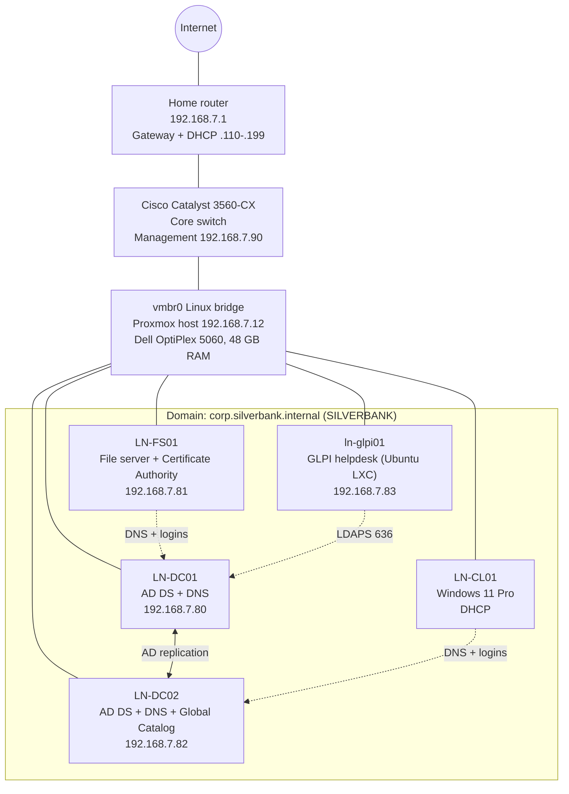

# SilverBank Lab Documentation

> Home lab project. SilverBank is a fictional company, built on my own Proxmox server to practise Windows Server 2025 administration and helpdesk work. No real company data, passwords or public IP addresses are included.

Last updated: 5 November 2026

## Overview

SilverBank is a fictional small bank with about 35 employees. Its servers run on my Proxmox homelab, a Dell OptiPlex 5060 (i7-8700, 48 GB RAM), and its network is being built on a physical Cisco Catalyst 3560-CX switch. Staff report problems through a **GLPI** helpdesk connected to Active Directory, and I solve them as the technician.

| Item | Value |
| --- | --- |
| Domain (forest root) | corp.silverbank.internal |
| NetBIOS name | SILVERBANK |
| Functional level | Windows Server 2025 |
| Head office site code | LN (London) |
| Naming pattern | LOCATION-ROLE## (e.g. LN-DC01) |
| Course followed | Windows Server 2025 Essential Training (LinkedIn Learning, Robert McMillen) |

The lab is a practice environment for entry-level support and sysadmin roles.

## Documentation

Every guide shows the **GUI steps first**, then **PowerShell (optional)**, then **how to check it worked**.

| Folder | Contents |
| --- | --- |
| [`01-active-directory/`](01-active-directory/README.md) | First DC, second DC, file server (shares + NTFS), clients, AD troubleshooting and error codes |
| [`02-dns/`](02-dns/README.md) | DNS Manager and zones, reverse lookup zone, A/CNAME/PTR records, aging and scavenging, troubleshooting |
| [`03-dhcp/`](03-dhcp/README.md) | DHCP reference: install, scopes and options, reservations, failover, relay, troubleshooting (not applied in the lab yet) |
| [`04-glpi/`](04-glpi/README.md) | GLPI helpdesk: installation, AD login over LDAPS, technician cheat sheet, maintenance, troubleshooting |
| [`tickets/`](tickets/README.md) | Practice helpdesk tickets, solved and documented step by step |
| [`learning-log/`](learning-log/README.md) | One short note per study session |

## Network diagram



Solid lines are network connections. Dotted lines show which servers the members use for DNS and authentication (each member uses both DCs).

## Server inventory

| ID | Name | Role | OS | IP | RAM | Preferred DNS | Alternate DNS |
| --- | --- | --- | --- | --- | --- | --- | --- |
| 200 | LN-DC01 | First DC, DNS (created the forest), PDC Emulator | Server 2025 Desktop Experience | 192.168.7.80 (static) | 4 GB | 192.168.7.82 | 127.0.0.1 |
| 202 | LN-DC02 | Second DC, DNS, Global Catalog | Server 2025 Desktop Experience | 192.168.7.82 (static) | 4 GB | 192.168.7.80 | 127.0.0.1 |
| 201 | LN-FS01 | File server, Windows Admin Center, Enterprise Root CA (`corp-LN-FS01-CA`) | Server 2025 Desktop Experience | 192.168.7.81 (static) | 4 GB | 192.168.7.80 | 192.168.7.82 |
| 220 | LN-CL01 | Employee PC | Windows 11 Pro 25H2 | DHCP (router) | 4 GB | 192.168.7.80 | 192.168.7.82 |
| 230 | ln-glpi01 | GLPI 12 helpdesk (LXC container) | Ubuntu 26.04 LTS | 192.168.7.83 (static) | 2 GB | 192.168.7.80 | 192.168.7.82 |

Common VM settings: q35, OVMF (UEFI) with Secure Boot keys, TPM 2.0, VirtIO SCSI single, disks on ZFS (NVMe) with Discard, CPU type host, QEMU guest agent on. All servers use the **GMT Standard Time** zone.

## IP address plan

The home LAN is 192.168.7.0/24. Static devices use addresses below .110; the router's DHCP hands out .110-.199.

| Range | Use |
| --- | --- |
| .1 | Home router (gateway) |
| .2 - .109 | Static: servers, VMs, cameras |
| .110 - .199 | DHCP: home devices, lab clients |
| .200 - .254 | Free for the future |

| IP | Device | DNS name | Type |
| --- | --- | --- | --- |
| 192.168.7.1 | Home router | | Gateway |
| 192.168.7.12 | Proxmox host | `pve` | Static |
| 192.168.7.50 | edge-nginx (SilverBank app) | | Static |
| 192.168.7.60 | db-postgresql (SilverBank app) | | Static |
| 192.168.7.70 | monitoring-staging (SilverBank app) | | Static |
| 192.168.7.80 | LN-DC01 | `ln-dc01` | Static |
| 192.168.7.81 | LN-FS01 | `ln-fs01` | Static |
| 192.168.7.82 | LN-DC02 | `ln-dc02` | Static |
| 192.168.7.83 | GLPI helpdesk | `ln-glpi01`, alias `helpdesk` | Static |
| 192.168.7.90 | Cisco Catalyst 3560-CX (management) | `sw-core01` | Static |
| 192.168.7.101 | prod-vm1-BLUE (SilverBank app) | | Static |
| 192.168.7.102 | prod-vm2-GREEN (SilverBank app) | | Static |

The guest Wi-Fi is a separate, isolated network. These addresses are temporary: the plan moves SilverBank to its own VLANs on the 3560-CX.

## Physical network lab

| Device | Model | Details |
| --- | --- | --- |
| Core switch | Cisco Catalyst WS-C3560CX-12TC-S | 12 x gigabit ports, Layer 3 (can route between VLANs), fanless |
| Cabling | Cat6 U/UTP solid copper (OFC), LSZH | Cables crimped by hand, T568B, checked with a cable tester |
| Console access | USB console cable | For the switch's console port |

Status (November 2026): the switch sits between the home router and the Proxmox host, with management IP 192.168.7.90. The SilverBank VLANs are not configured yet.

Planned SilverBank network on the switch:

| VLAN | Name | Subnet (planned) | Used by |
| --- | --- | --- | --- |
| 10 | Servers | 10.10.10.0/24 | Domain controllers, file server |
| 20 | Staff | 10.10.20.0/24 | Employee PCs |
| 30 | Management | 10.10.30.0/24 | IT admin access, switch management |
| 99 | Guest | 10.10.99.0/24 | Internet only, isolated |

What I plan to configure: VLANs and access ports, an 802.1Q trunk to Proxmox, SVIs for inter-VLAN routing, a DHCP relay (`ip helper-address`) to the domain controllers, and ACLs to keep the Guest VLAN away from the servers. Every configuration is tested in Packet Tracer first.

## Accounts and logins

Passwords are kept in a password manager, never in this repository.

| Account | Type as | Exists on | Use for |
| --- | --- | --- | --- |
| Domain admin | `SILVERBANK\Administrator` | Active Directory (all machines) | Admin work |
| Local admin | `.\Administrator` | LN-FS01 only | Emergencies (domain broken) |
| Local setup account | `.\<setup name>` | LN-CL01 only | Emergencies |
| DSRM | (set at promotion) | Each DC | Repairing Active Directory |
| `svc_glpi` | (service account) | Active Directory, OU `Service Accounts` | GLPI reads AD over LDAPS — never logs in interactively |
| `glpi` | GLPI internal database | GLPI | Break-glass helpdesk admin |
| `marius` | SSH key + sudo | ln-glpi01 | Linux administration (root SSH login is blocked) |

- Domain controllers have no local accounts after promotion.
- Later: a personal daily account and a separate admin account instead of the built-in Administrator.

## Proxmox operations

Start the domain controllers first and shut them down last.

| Order | VM / CT | Startup delay | Shutdown timeout |
| --- | --- | --- | --- |
| 1 | 200 LN-DC01 | 180 s | 180 s |
| 2 | 202 LN-DC02 | 120 s | 180 s |
| 3 | 201 LN-FS01 | 30 s | 180 s |
| 4 | 220 LN-CL01 | - | 180 s |
| 5 | 230 ln-glpi01 | - | - |

The order applies only to host boot, host shutdown and Bulk Start / Bulk Shutdown, not to single VMs.

```bash
qm set 200 --startup order=1,up=180,down=180
qm set 202 --startup order=2,up=120,down=180
qm set 201 --startup order=3,up=30,down=180
qm set 220 --startup order=4,down=180
pct set 230 --startup order=5
```

Safe manual shutdown:

```bash
pct shutdown 230                # ln-glpi01
qm shutdown 220 --timeout 180   # LN-CL01
qm shutdown 201 --timeout 180   # LN-FS01
qm shutdown 202 --timeout 180   # LN-DC02
qm shutdown 200 --timeout 180   # LN-DC01 last
qm list; pct list
```

Check the QEMU guest agent on all running VMs:

```bash
for id in $(qm list | awk '$3=="running"{print $1}'); do
  echo -n "VM $id: "
  qm agent $id ping 2>/dev/null && echo "agent OK" || echo "no agent"
done
```

RAM: 48 GB since October 2026 (2 x 16 GB + 2 x 8 GB, DDR4-2666). memtester passed on 36 GB.

## Backups and shadow copies

Tested on the file server (LN-FS01) in October 2026: a **Windows Server Backup** with a tested restore, and a file restored with **Volume Shadow Copy** (Previous Versions).

| | Shadow Copy | Windows Server Backup | Proxmox backup |
| --- | --- | --- | --- |
| What | Snapshots of a volume | Files, folders or the whole server | The whole VM |
| Restore speed | Seconds | Minutes | Minutes to hours |
| Protects against | Deleted or overwritten files | Data loss, if stored on another disk | The whole server failing |
| Who restores | The user (Previous Versions) | IT | IT |

Rules I follow:

- **A backup you haven't restored isn't a backup.** Always test a restore.
- **A backup on the same disk as the data is a single point of failure.**
- **3-2-1 rule:** 3 copies, on 2 types of storage, 1 copy off-site.
- Shadow copies are kept on the same volume by default, so they don't replace backups.

## Course progress

I chose the lessons most useful for a Level 1 helpdesk role and practise each one in the lab.

| Lesson | Status |
| --- | --- |
| Install AD DS, two domain controllers | Done |
| Join servers and clients to the domain | Done |
| Backing up Windows Server 2025 | Done |
| Volume Shadow Copy | Done |
| File server security (NTFS and share permissions) | Done — see [TICKET-001](tickets/TICKET-001-finance-folder-access.md) |
| DNS: reverse zone, records, aging and scavenging | Done |
| Active Directory Certificate Services (for LDAPS) | Done |
| Event logs for troubleshooting | Next |
| Network printing | To do |
| Task Manager, Performance Monitor | To do |
| IIS, Hyper-V, Containers | Skipped for now (less relevant for helpdesk) |

## Troubleshooting highlights

DNS caused most problems: check that the machine uses the DCs as DNS before anything else. Full logs are in each folder's troubleshooting guide.

| Date | Problem | Cause | Fix |
| --- | --- | --- | --- |
| Nov 2026 | Plain LDAP bind refused: "Strong(er) authentication required" | WS2025 DCs require LDAP signing | Built an Enterprise Root CA and switched GLPI to **LDAPS (636)** |
| Nov 2026 | Certificate request: "RPC server is unavailable" | No DNS record for the CA server; LN-DC01's DNS pointed to the router (Hyper-V vEthernet adapter) | Added the record; fixed DC01's DNS client |
| Nov 2026 | "Certificate is not yet valid" | Servers on Pacific Time (Windows default) | GMT Standard Time on every server, time resync |
| Nov 2026 | Employee can't log in to GLPI (`data 52e`) | Wrong password: US keyboard, UK layout; first reset never saved | Reset, verified `PasswordLastSet` |
| Nov 2026 | "Access denied" on the Finance share | User moved department, not in `GG_Finance` | Manager approval, added to the group — [TICKET-001](tickets/TICKET-001-finance-folder-access.md) |
| Oct 2026 | LN-CL01: "AD domain controller could not be contacted" | Client DNS was the router | Set DNS to .80 and .82 |
| Oct 2026 | Ping by IP worked, by name failed | No DNS record for LN-FS01 | Joined the domain / `ipconfig /registerdns` |
| Sep 2026 | LN-DC02 promotion: wrong user or password | Wizard used the local account | Used `SILVERBANK\Administrator` |
| Sep 2026 | Proxmox root disk at 75% | 7 old kernels (8.4 GB) | Purged old kernels, `apt clean`, journal limit: down to 62% |

Details: [AD](01-active-directory/05-troubleshooting.md) · [DNS](02-dns/05-troubleshooting.md) · [GLPI](04-glpi/05-troubleshooting.md)

## Next steps

- [x] Windows Server Backup with a tested restore
- [x] Volume Shadow Copy restore
- [x] SilverBank OUs, groups and users
- [x] File shares on LN-FS01 with NTFS permissions per department
- [x] Reverse DNS lookup zone and records for Linux servers and the switch
- [x] GLPI helpdesk connected to Active Directory over LDAPS
- [x] First helpdesk ticket solved and documented
- [ ] Weekly helpdesk ticket practice (easy → harder)
- [ ] Event Viewer: practise an account lockout (event ID 4740) and unlock the user
- [ ] Group Policy: password policy, mapped drives, allow ping on servers
- [ ] Network printing
- [ ] Microsoft 365 basics
- [ ] Move backups to a separate disk and schedule them
- [ ] Console into the Cisco 3560-CX and set a basic secure configuration
- [ ] SilverBank VLANs in Packet Tracer, then on the real switch; DHCP relay to the DCs
- [ ] HTTPS for GLPI with a certificate from the SilverBank CA